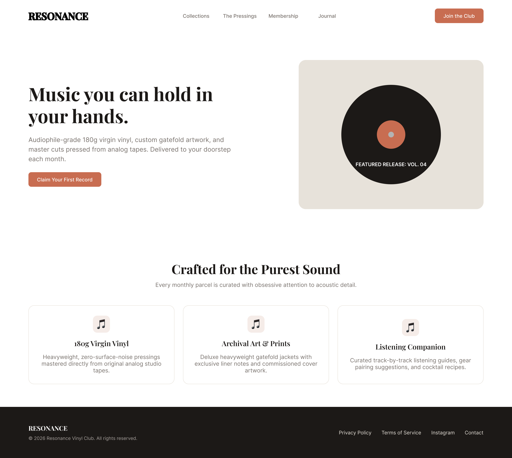

# Resonance — Vinyl Subscription & Hi-Fi Club

## 1. Project Overview & Concept
**Resonance** is a boutique direct-to-consumer vinyl subscription service tailored for audiophiles, analog sound purists, and modern music collectors. 

Subscribers receive monthly parcels containing heavyweight 180g virgin vinyl pressings mastered directly from original analog tapes, accompanied by custom gatefold jacket artwork, deluxe liner notes, and pairing guides.

---

## 2. Target Audience
* **Audiophiles & Hi-Fi Enthusiasts:** Listeners seeking acoustic clarity, analog depth, and dynamic range that standard compressed streaming formats lack.
* **Aesthetic-Conscious Collectors:** Design-oriented music fans who value physical gatefold packaging, exclusive vinyl editions, and artistic print materials.
* **Curated Discovery Seekers:** Individuals interested in deep-dive liner notes, artist essays, gear recommendations, and curated track-by-track tasting notes.

---

## 3. Design System & Rationale

### Color Palette (Saved Local Styles)
* **`Brand / Terracotta` (`#C86D51`):** A warm, vintage rust-terracotta tone used for primary call-to-action buttons and key focal accents, evoking the warmth of analog tubes.
* **`Surface / Cream` (`#FDFBF7`):** An off-white, matte-paper background tone that softens digital glare and delivers a tactile, print-editorial aesthetic.
* **`Text / Primary` (`#1C1917`):** Deep warm espresso used for headlines, navigation items, and high-contrast elements.
* **`Text / Secondary` (`#78716C`):** A muted warm neutral for body text, subtitles, and metadata.

### Typography Hierarchy (Saved Text Styles)
* **Display Heading (`Heading 1`):** Playfair Display / Bold, 48px–52px (Line height: 1.2) for the hero title.
* **Section Heading (`Heading 2`):** Playfair Display / SemiBold, 28px–36px for feature section titles.
* **Body Text (`Body`):** Inter / Regular, 16px (Line height: 1.5) for readability across descriptive sections.
* **UI & Navigation (`Button Text`):** Inter / Medium, 14px for interactive elements and navigation bar links.

---

## 4. Reusable Components (Auto Layout)
The design includes three core reusable components adhering to atomic design principles:
1. **`Button / Primary`:** A flexible button component built with horizontal Auto Layout (`Hug contents`, `24px` horizontal padding, `12px` vertical padding, `8px` corner radius).
2. **`Card / Feature`:** A multi-layered responsive card component with vertical Auto Layout (`Fill container`, internal icon container, heading, and body text).
3. **`Nav / Link`:** A consistent navigation component utilizing Auto Layout padding for consistent hit targets.

---

## 5. Page Structure & Auto Layout Architecture
The master layout is assembled into a single responsive frame (`Resonance - Desktop Landing Page`, 1440px width) containing four modular, vertically stacked Auto Layout sections:
1. **Header / Navbar:** Logo pinned left, centered navigation links grouped with a 32px gap, and CTA button pinned right using `Space between` distribution.
2. **Hero Section:** Two-column split layout with responsive content hierarchy on the left and a custom vinyl record illustration on the right.
3. **Features Section:** Section header followed by a 3-card equal-width responsive flex row (`Fill container`).
4. **Footer:** Dark theme bar with branding, copyright metadata, and secondary policy links.

---

## 6. Deliverables & Links
* **Figma File (View Access):** https://www.figma.com/design/ivLzE4tTPVIh5pyAEkRQpK/Resonance?node-id=0-1&t=0tGYLxmwUldqkHEY-1
* **Desktop Preview:**
  
